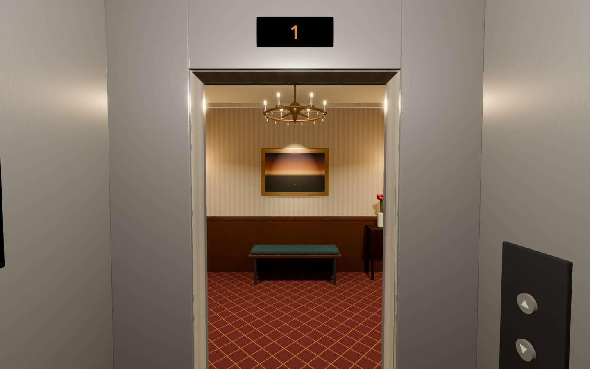
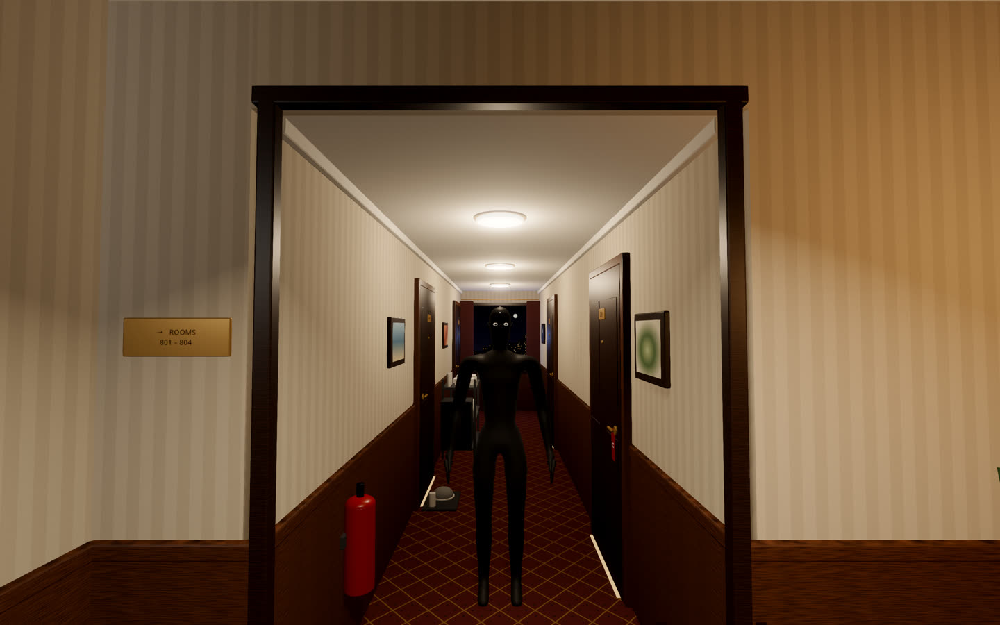

<!-- Placeholder left: [APP STORE URL] (known once the app is on the Mac App Store).
     When it is: replace the "Coming soon" line below with
     [Download on the Mac App Store]([APP STORE URL]) -->

# The Alder Lift

**A hotel elevator anomaly hunt for Mac.**

The doors open. The lobby looks exactly the way it did on floor 1. Or does it?

Ride the elevator up through the Alder Hotel at 3:17 a.m. If nothing has changed, press **UP**. If anything is different, photograph it, then press **DOWN**. One wrong call and you're back on floor 1.

**Coming soon to the Mac App Store.**

***

[Support](SUPPORT.md) · [Privacy Policy](PRIVACY_POLICY.md) · [Contact](mailto:rcsoftlabs@gmail.com)
